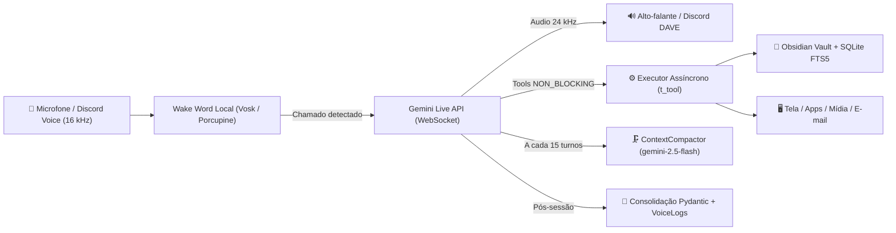

<div align="center">

# 🎙️ Ren — Real-Time AI Voice Assistant & Discord Companion

**Assistente de voz local de ultra-baixa latência com Gemini Multimodal Live API, chamadas de voz no Discord (DAVE E2EE), Segundo Cérebro no Obsidian (SQLite FTS5 + Gemini 2.5 Pro), Visão de Tela e HUD Holográfico 3D.**

[](https://www.python.org/)
[](https://ai.google.dev/)
[](https://discordpy.readthedocs.io/)
[](https://obsidian.md/)
[](tests/)

</div>

---

## ✨ Destaques

- **🎧 Standby de Custo Zero (CPU Local):** Fica em espera ouvindo a wake word offline via **Vosk (PT-BR)**, **Picovoice Porcupine** ou teclado, sem abrir conexões nem gastar API até ser chamada.
- **⚡ Streaming Bidirecional de Baixa Latência:** Envia áudio PCM `16 kHz` e reproduz síntese nativa `24 kHz` em tempo real com **cancelamento de eco acústico (AEC)**, *barge-in* e VAD local (**Silero ONNX** + filtro espectral).
- **🎮 Modo Call no Discord (`--mode call`):** Entra em canais de voz com suporte completo a **DAVE E2EE** (`davey >= 0.2`), sincronização dinâmica de chaves no `AudioReader`, identificação de falantes por ID/perfil e filtro de **Áudio Proativo** para não interromper conversas paralelas.
- **🧠 Segundo Cérebro no Obsidian + SQLite FTS5:**
  - Indexa o cofre Obsidian em UTF-8 no **SQLite FTS5** sincronizado por Triggers SQL (`search_obsidian_notes`).
  - Salva notas de voz com **frontmatter YAML** em `VoiceNotes/` (`create_voice_note`).
  - **Organizador Inteligente (`organize_obsidian_vault`):** Delega para o modelo de texto **`gemini-2.5-pro`** (fallback `gemini-2.5-flash`) via Structured Outputs para estruturar notas, criar **`[[wikilinks]]`** e montar **MOCs** (Mapas de Conteúdo).
  - **Compactação Incremental (`ContextCompactor`):** A cada 15 turnos não compactados, resume com `gemini-2.5-flash` e injeta o `rolling_summary` silenciosamente (`turn_complete=False`).
  - **Consolidação Pós-Sessão:** Operações `ADD` / `UPDATE` / `DELETE` por ID (Pydantic) sem duplicatas no SQLite + geração de resumo diário em `VoiceLogs/YYYY-MM-DD - Resumo.md`.
- **🛡️ Sessões Longas Blindadas:** `ContextWindowCompression` (sliding window) + `SessionResumption` com reconexão transparente em `go_away` e quedas de WebSocket.
- **🖥️ Controle do PC, Visão e Briefing:** Captura de tela em tempo real (`look_at_screen`), Spotify/YouTube (`play_music`), controle de mídia/volume, abertura de apps, clipboard, leitura/busca de e-mails IMAP, timers falados e briefing executivo.
- **🌌 HUD 3D Opcional (`ren-hud/`):** Interface desktop em **Tauri v2 + React 19 + Three.js** conectada via WebSocket local (`ws://localhost:8765`).

---

## 🏗️ Arquitetura



---

## 📁 Estrutura do Projeto

```text
Ren/
├── run.py                       # Orquestrador principal (--mode pc | --mode call)
├── start-ren-pc.cmd             # Atalho Windows: Modo PC
├── start-ren-call.cmd           # Atalho Windows: Modo Call Discord
├── requirements.txt             # Dependências Python
├── .env.example                 # Template de variáveis de ambiente
├── pytest.ini                   # Configuração do pytest
├── data/
│   ├── persona.example.json     # Modelo de personalidade/estilo
│   └── friends.example.json     # Modelo de perfis de amigos no Discord
├── knowledge/                   # Base local de documentos (.md / .txt)
├── models/                      # Modelos locais (silero_vad.onnx, Vosk, .ppn)
├── ren-hud/                     # HUD Desktop 3D (Tauri v2 + React + Three.js)
├── src/
│   ├── config.py                # Settings (.env) e especificações de áudio
│   ├── audio/                   # AEC, VAD (RMS + Silero), SoundFX, StreamManager
│   ├── core/                    # EdgeRouter e SlowLoopManager
│   ├── detector/                # Wake word (Porcupine / Vosk / Teclado)
│   ├── discord_bot/             # Bot de voz/texto Discord + Patch DAVE E2EE
│   ├── gateway/                 # Servidor WebSocket para telemetria e HUD
│   ├── gemini/                  # Sessão Live, Prompts, Tools NON_BLOCKING
│   ├── memory/                  # SQLite FTS5, Compactor, ObsidianOrganizer
│   ├── system/                  # Briefing, E-mail IMAP, Ações PC, Timers
│   └── vision/                  # Captura de tela em tempo real
└── tests/                       # Suíte automatizada (115 testes pytest)
```

---

## 🚀 Instalação e Configuração

### 1. Ambiente Python
```powershell
git clone https://github.com/SEU_USUARIO/Ren.git
cd Ren
python -m venv .venv
.\.venv\Scripts\activate
pip install -r requirements.txt
```

### 2. Variáveis de Ambiente (`.env`)
Copie o template e preencha suas chaves:
```powershell
copy .env.example .env
```

| Variável | Obrigatória | Descrição |
| :--- | :---: | :--- |
| `GEMINI_API_KEY` | Sim | Chave da Gemini API (Google AI Studio) |
| `GEMINI_MODEL` | Não | Modelo Live (`gemini-3.8-live` ou `gemini-3.8-live-extended-thinking`) |
| `GEMINI_VOICE` | Não | Voz pré-construída (`Zephyr`, `Aoede`, `Kore`, `Leda`, `Puck`, `Charon`, `Fenrir`, `Orus`) |
| `THINKING_LEVEL` | Não | Nível de raciocínio para modelos `-thinking` (`LOW`, `MINIMAL`, `MEDIUM`, `HIGH`) |
| `OBSIDIAN_VAULT_PATH` | Não | Caminho raiz do seu cofre Obsidian (ex.: `C:\Projetos\cofre-Ren`) |
| `DISCORD_BOT_TOKEN` | Não | Token do bot para chamadas de voz no Discord |
| `DISCORD_USER_ID` | Não | Seu ID numérico do Discord para identificação automática |
| `DISCORD_DEFAULT_CHANNEL` | Não | Canal de voz padrão (ex.: `Geral`) |
| `DISCORD_TEXT_CHANNEL_ID` | Não | Canal de texto para envio de transcrições/fontes |

### 3. Personalidade e Amigos (Opcional)
```powershell
copy data\persona.example.json data\persona.json
copy data\friends.example.json data\friends.json
```

---

## 🎮 Como Usar

- **Modo PC (microfone local):**
  ```powershell
  .\.venv\Scripts\python.exe run.py --mode pc
  ```
- **Modo Discord Call:**
  ```powershell
  .\.venv\Scripts\python.exe run.py --mode call
  ```
  Com canal ou modelo específico:
  ```powershell
  .\.venv\Scripts\python.exe run.py --mode call --channel "Geral" --model gemini-3.8-live
  ```

---

## 🧪 Testes

- **Suíte completa (offline, com mocks):**
  ```powershell
  .\.venv\Scripts\pytest.exe -q
  ```
- **Smoke test ao vivo na Gemini Live API:**
  ```powershell
  .\.venv\Scripts\python.exe -m tests.smoke_gemini_38_live --full
  ```
